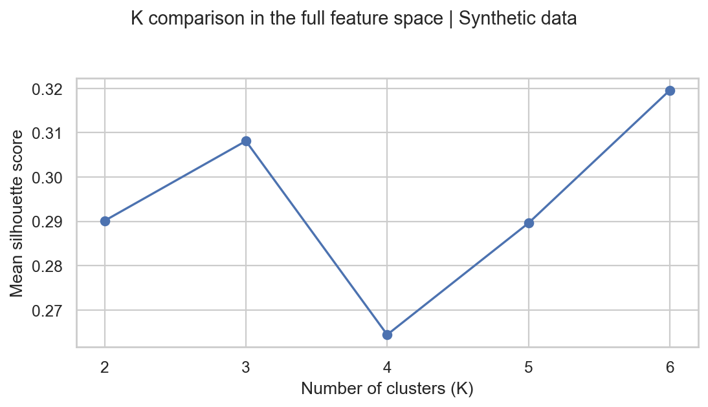
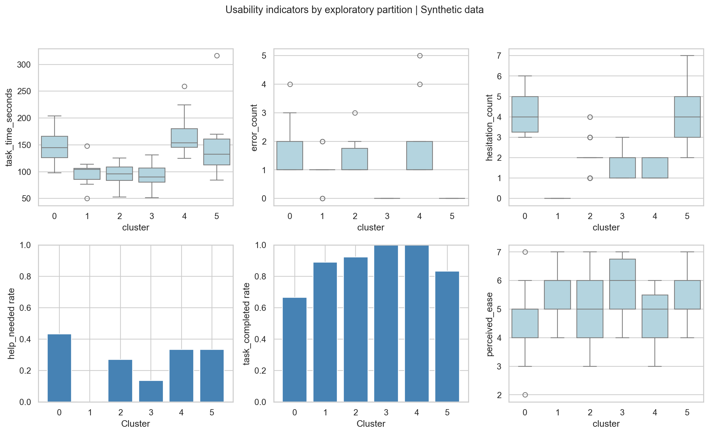

# Data Science for UX Research: Pix usability

A reproducible Python project exploring behavioral variation in **120 synthetic
usability sessions** for a Pix transfer journey. All data are simulated and all
results are exploratory. This is not evidence about real bank customers.

## Run locally

Install Python 3.11–3.13 (validated with Python 3.13) and Git before starting.
Python is available from [python.org](https://www.python.org/downloads/), and Git
from [git-scm.com](https://git-scm.com/downloads). On Windows, enable the Python
launcher during installation so the `py` command is available. Reopen your
terminal after installing these tools.

Choose the instructions for your operating system and terminal. Run each command
in order, one line at a time. The first two commands download the repository and
enter its folder. If you already have a local copy, open a terminal in the folder
containing `README.md` and `requirements.txt` and skip those two commands.

### macOS and Linux

Open Terminal. Check that `python3 --version` reports Python 3.11, 3.12 or 3.13,
then create and activate the virtual environment, install dependencies, run the
analysis and run the basic tests:

```bash
git clone https://github.com/AndrezzaNascimento6/ux-research-data-science-pix.git
cd ux-research-data-science-pix
python3 --version
python3 -m venv .venv
source .venv/bin/activate
python -m pip install -r requirements.txt
python -m src.analysis
python -m pytest -q
```

If Linux reports that `venv` or `ensurepip` is unavailable, install the virtual
environment package for your Python version using your distribution's package
manager, then retry environment creation.

### Windows: PowerShell

Open PowerShell. Check that `py --version` reports Python 3.11, 3.12 or 3.13.
Use this sequence to create and activate the virtual environment, install
dependencies, run the analysis and run the basic tests:

```powershell
git clone https://github.com/AndrezzaNascimento6/ux-research-data-science-pix.git
cd ux-research-data-science-pix
py --version
py -m venv .venv
.\.venv\Scripts\Activate.ps1
python -m pip install -r requirements.txt
python -m src.analysis
python -m pytest -q
```

If PowerShell blocks activation because scripts are disabled, use the CMD
instructions below in the same project folder, starting with `py --version`.

### Windows: Command Prompt (CMD)

Open Command Prompt and run:

```bat
git clone https://github.com/AndrezzaNascimento6/ux-research-data-science-pix.git
cd ux-research-data-science-pix
py --version
py -m venv .venv
.venv\Scripts\activate.bat
python -m pip install -r requirements.txt
python -m src.analysis
python -m pytest -q
```

### Outputs and later runs

The analysis prints the session count, selected K and silhouette score. Generated
tables, six PNG charts and `report.md` appear in `outputs/`; the synthetic dataset
appears in `data/`. The test command should report `3 passed`.

For later runs, open a terminal in the project folder, activate `.venv` using the
command for your terminal above, then run `python -m src.analysis`. Dependencies
only need to be installed again if the environment is recreated or requirements
change. Run `deactivate` when you are finished.

No notebook, external dataset, credentials, dashboard or service integration is
required. Matplotlib uses a noninteractive backend, so charts are saved to files
rather than opened in a window. Rerunning the pipeline overwrites generated files
in `data/` and `outputs/`. Run all project commands from the repository root.

## Repository structure

```text
data/synthetic_pix_sessions.csv   Generated session-level dataset
src/generate_data.py              Fixed-seed synthetic data generator
src/analysis.py                   EDA, scaling, K selection, figures and report
outputs/                         Generated CSV tables, six PNGs and report.md
claude/                          Compact context, exported summary and manual prompt
tests/test_pipeline.py            Data, clustering and end-to-end checks
requirements.txt                 Pinned direct dependencies
```

## Scenario and data dictionary

Each row represents a different simulated participant attempting to enter a Pix
recipient, enter an amount, review and confirm a transfer in a test environment.
No actual transfer occurs. Completion can include moderator assistance; the data
do not measure unassisted success separately.

| Column | Meaning |
| --- | --- |
| `session_id` | Unique synthetic session identifier; excluded from modeling |
| `task_time_seconds` | Elapsed seconds until confirmation or stopping |
| `error_count` | Count of observable incorrect actions or entries |
| `hesitation_count` | Count of pauses of at least three seconds before an action |
| `help_needed` | 1 if moderator help was needed; otherwise 0 |
| `task_completed` | 1 if transfer confirmation was reached; otherwise 0 |
| `perceived_ease` | Integer post-task ease rating: 1 very difficult, 7 very easy |

These operational definitions are simulation assumptions, not measurements from
recordings or a validated questionnaire.

## Generation and methodology

NumPy's generator uses seed **42**. A single normally distributed continuous
friction variable introduces modest shared variation. Errors and hesitations
follow Poisson distributions with log-linked rates; time has a lognormal baseline
plus event-related delays. Help and completion are Bernoulli draws with logistic
probabilities. Ease is a noisy continuous response rounded and clipped to 1–7.
No mixture classes, manually assigned personas, separation targets or seed search
are used. Plausibility is qualitative: these distributions are not calibrated to
empirical Pix research. Latent friction is not exported or included in clustering.

Pandas produces descriptive statistics and Spearman correlations. Histograms show
skew, discrete frequencies and outcome variation. Overall duration and successful
completion duration are reported separately because failed sessions end at stopping.

K-Means uses `task_time_seconds`, `error_count` and `hesitation_count`.
`log1p` reduces right skew; `StandardScaler` then gives each feature unit variance.
This equal weighting is a modeling choice, not a validated importance ranking.
Help is held out because a rare binary event can dominate standardized Euclidean
distance. Completion and ease are held out as usability outcomes rather than
inputs that predetermine the comparison.

Each K from **2 through 6** is fitted with seed 42 and `n_init=30`. Mean silhouette
is computed in the full three-dimensional standardized space; the largest score
selects a descriptive partition (ties favor smaller K). Inertia is also exported.
PCA is used only for visualization, with explained variance shown on axes.

Silhouette ranges from -1 to 1; higher values indicate better within/between-cluster
distance separation. A maximum within a tested range is not proof of real
segments. K-Means always partitions data, including continuous distributions.
Individual silhouettes, sample sizes, overlapping plots and study context must
inform interpretation. No automatic threshold is used to declare user profiles.

## Results and artifacts

Read [the generated findings](outputs/report.md) for the selected K, measured
silhouette, completion/help rates, ease and interpretation. Inspect:

- `distributions.png` and `descriptive_statistics.csv`: overall usability indicators.
- `correlations.png` and `spearman_correlations.csv`: monotonic associations.
- `k_comparison.png` and `k_comparison.csv`: all five candidate K values.
- `clusters.png`: PCA and observed-variable views of the same partitions.
- `silhouette.png`: individual separation diagnostics, including negative values.
- `cluster_indicators.png` and `cluster_indicators.csv`: distributions, sizes,
  behavioral means, completion/help rates and ease by cluster.
- `clustered_sessions.csv`: assignments and individual silhouette values.

The partitions are exploratory summaries, not validated distinct behavioral
profiles. Outcome differences partly reflect assumptions built into the generator.
Do not infer causality, statistical significance or product performance from them.

### Visual overview





### Manual interpretation with Claude

The [Claude prompt](claude/claude_prompt.md) explains how to use only the compact
[research context](claude/research_context.md) and
[cluster summary](claude/analysis_summary.csv). These files reuse existing pipeline
results without refitting K-Means. They emphasize synthetic data, weak separation
at silhouette 0.320, and the distinction between observations and untested hypotheses.
This is a manual handoff; no API integration or generated Claude interpretation
is included.

## Limitations and next research steps

Synthetic samples cannot establish real personas or diagnose specific screens.
Poisson counts assume conditional equality of mean and variance; real pauses and
errors may be more dispersed. Ease is ordinal, and its mean is only a compact
description. K-Means favors Euclidean, roughly spherical partitions and is
sensitive to transformations, outliers and correlated inputs. Combining stopping
times with completion times can also distort comparisons. The sample is small;
no stability resampling, holdout validation or population inference is performed.

In a real study, collect consented observations, timestamps by journey step,
moderator intervention logs and qualitative explanations. Validate candidate
patterns across new participants and alternative preprocessing before using them
to guide interface changes. Do not interpret simulated metrics as benchmarks.

## Validation and reproducibility

Tests cover fixed-seed reproducibility, valid ranges, unique IDs, mixed binary
outcomes, standardization, K selection, deterministic assignments and complete
artifact generation in a temporary directory. Versions are pinned for direct
dependencies; transitive dependencies and numerical libraries can still vary
across platforms, and cluster labels have no intrinsic ordering or meaning.

## Technical references

- [Scikit-learn: silhouette score](https://scikit-learn.org/stable/modules/generated/sklearn.metrics.silhouette_score.html)
- [Scikit-learn: StandardScaler](https://scikit-learn.org/stable/modules/generated/sklearn.preprocessing.StandardScaler.html)
